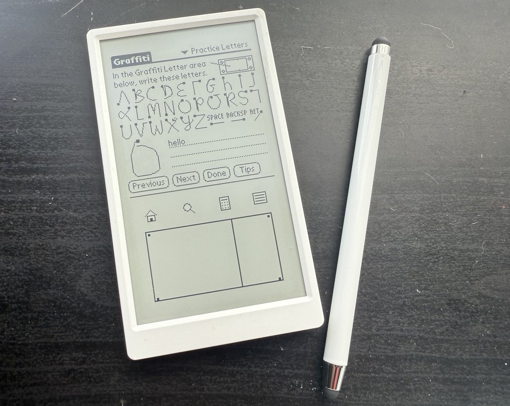
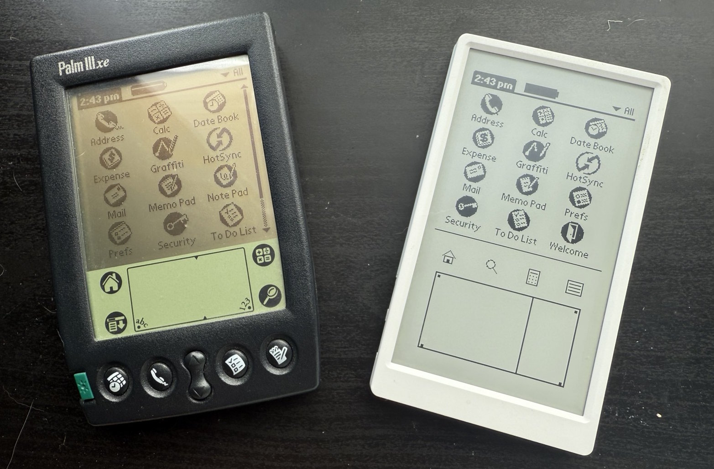

# Dragonfruit for JC4827W543

This checkout targets the **JC4827W543 with resistive XPT2046 touchscreen**.
It boots into a menu that starts either **Palm OS** or a **Cybiko Xtreme**
emulator, each loading its ROM from its own folder on a FAT32 SD card. See the
[board setup, build, flash and touch calibration guide](docs/jc4827w543.md),
the [Cybiko Xtreme guide](docs/cybiko.md) (with technical references on
[how the Cybiko works](docs/cybiko-internals.md) and the
[MP3 cartridge and MXD video](docs/cybiko-mp3-cartridge.md)) and the
[example SD configuration](palm-jc4827w543.cfg.example).

```sh
./tools/build-jc4827w543.sh
```

Copy your Palm IIIx ROM to the SD card as `/PalmOS/palm.rom`, and the Cybiko
ROM and flash images to `/Cybiko`. The build creates
`build-jc4827w543/dragonfruit-jc4827w543.bin` for flashing at address `0x0`.

The upstream overview below describes the emulator and its original hardware.

An emulator of the Motorola MC68EZ328 ("DragonBall EZ"), the 68000-based
system-on-chip at the heart of the late-90s Palm handhelds, with enough of the surrounding
machine modeled to boot stock Palm OS 3.x and run it. Everything is written from scratch in
portable C: a 68000 interpreter plus models of the DragonBall's on-chip peripherals
(interrupt controller, timer, RTC, GPIO, SPI, UART, LCD controller).

The core has no platform dependencies. It runs headless on a PC for development and on ESP32
hardware for the real thing. The original reference target is the **M5Paper**, an ESP32 board with an
e-ink panel and a capacitive touchscreen, which the emulator turns into a working Palm IIIx:
it boots to the launcher, runs the first-boot setup wizard, and takes stylus input including
Graffiti handwriting.

You supply the ROM. Palm OS is copyrighted and is not included here; see [Running it](#running-it).



## What works

- Boots Palm OS 3.1 from a stock Palm IIIx ROM, all the way to the launcher, on both the PC
  host and the device.
- First-boot setup wizard: welcome, digitizer calibration, country / time / date.
- Stylus input: taps, the silkscreen buttons (Apps / Menu / Calc / Find), and Graffiti
  handwriting, all over one continuous digitizer surface that the ROM handles natively.
- Real-time clock and 100 Hz system tick driven by wall-clock time, so both stay correct
  regardless of emulation speed.
- Sleep and auto-off (the DragonBall's PLL-off `STOP` mode) with power-key wake through the
  modeled keyboard matrix. On the M5Paper this also drives the ESP32 into light sleep.
- Installs `.prc` / `.pdb` / `.pqa` files from the SD card into emulated RAM, and backs up or
  restores the device's databases to the card.
- Optional configurable on-screen layout: relocate or resize the silkscreen, rotate to
  landscape, or magnify, all from a file on the SD card.
- JC4827W543 internal serial PPP to Wi-Fi, with a Palm browser setup portal and
  IPv4 NAT/DNS plus an HTTPS-to-HTTP text browsing proxy. See
  [Wi-Fi setup and verification limits](docs/wifi.md).

## Portability

The project is the emulator, not any single board. The split is deliberate:

- **Core, portable C.** The 68000 interpreter, the DragonBall peripheral models, the bus, and
  the Palm OS integration (pen injection, the installer, backup/restore) carry no ESP-IDF or
  board dependencies. The PC host build compiles exactly this code with a thin shim standing
  in for ESP-IDF, which is what makes day-to-day work possible without flashing hardware.
- **Performance backend, per-ISA.** On device the hot path is a burst JIT that translates
  68000 blocks to native code. Its code generator sits behind a backend interface selected at
  build time, so a new instruction set is a new backend rather than a rewrite. The classic
  ESP32 (Xtensa) backend is complete; an ESP32-P4 (RISC-V) build links and runs
  interpreter-only while its backend is still to be written.
- **Board, peripherals.** The e-ink driver, touch controller, SD mount, and battery sensing
  live in their own components. Bringing up a different ESP32 board is a matter of writing
  those drivers, not touching the core.

On the ESP32 side the requirements are external PSRAM (the emulated RAM and the ROM
image live there) and two cores (the JIT's compiler runs on the second one). That rules out
single-core, no-PSRAM parts such as the ESP32-C3.

JC4827W543 exposes 2 MB Palm RAM and automatically checkpoints apps, data and settings
to SD for restoration through a normal Palm restart. See the [board guide](docs/jc4827w543.md#persistent-palm-ram-and-sd-applications)
for saving before unplugging and installing applications from `/install`.
Palm OS 4 also sees `/palm-card` on the SD as a virtual **SD Card** volume. Put
compatible apps in `/palm-card/PALM/Launcher` and choose **SD Card** in Palm's
launcher. See [virtual storage](docs/jc4827w543.md#storage-inside-palm-os-os-4)
for supported operations and limits.

## Hardware (M5Paper reference target)

- **SoC** — ESP32-D0WDQ6-V3, dual-core 240 MHz, 16 MB flash, 8 MB PSRAM.
- **Display** — IT8951 e-ink controller over SPI, 960×540 panel. The Palm's 160×160 1bpp
  framebuffer is scaled and rotated 90° counter-clockwise into a top-aligned portrait layout,
  with the Graffiti silkscreen rendered below it.
- **Touch** — GT911 capacitive controller over I²C.

## Repository layout

```
src/
  main/             ESP-IDF entry point and the FreeRTOS tasks (CPU, display, input, battery)
  components/
    m68k/           68000 interpreter (decode, addressing, ALU, move, branch, shift, bit,
                    BCD, system) plus the device-only burst JIT and its per-ISA backend
    bus/            24-bit address space: 2 MB RAM, ROM and peripherals
    dragonball/     MC68EZ328 peripherals: interrupt controller, timer, RTC, GPIO,
                    SPI (digitizer + battery ADC), UART, LCD controller
    display/        IT8951 e-ink driver; composites the framebuffer and silkscreen overlay
    input/          GT911 touch polling into a pen-event queue; button latches
    layout/         Panel-to-Palm coordinate mapping, shared by display and input
    config/         Reads the optional layout config off the SD card at boot
    rom_loader/     Loads the ROM from the SD card into PSRAM at boot
    palm_card/      Directory-backed Palm OS 4 VFS/Expansion Manager interface
    installer/      Installs PRC/PDB/PQA into RAM; backs up and restores databases
    m5_sd/          Shared microSD mount and board SPI ownership
  host/             PC build harness: runs the core headless, with esp_shim.h in place of
                    ESP-IDF and a PNG snapshotter (plus an optional SDL window) for the screen
tools/              Host-side scripts that drive the on-device serial debug console
reference/          Read-only reference emulators and datasheets, consulted for hardware
                    behavior and never copied (not committed; see below)
```

`reference/` holds third-party emulators (CloudpilotEmu, Mu, POSE) and vendor driver examples
used only to understand how the hardware behaves. It is not part of this repository's source
and is not committed.

## Running it

You need a Palm OS 3.x ROM for the Palm IIIx. It is not distributed here. The usual source is
to transfer it off a device you own (the classic Palm OS Emulator shipped a ROM-transfer tool
for exactly that).

### On a PC, no hardware

The fastest way to iterate. The host build compiles the same emulator core and writes a PNG
whenever the screen changes.

```
cmake -S src/host -B build-host
cmake --build build-host
./build-host/dragonfruit -r Palm-IIIx-3.1.rom -c 150000000
```

`-r` selects the ROM, `-c` caps the cycle count, `-i <file>` queues a PRC/PDB to auto-install,
`--state <prefix>` restores/saves RAM through alternating checkpoint files, and `-b <dir>`
exports RAM databases. The host defaults to 2 MB; use `-DPALM_RAM_MB=4` for a 4 MB experiment.
`--card <directory>` exposes a host directory as a Palm OS 4 expansion volume;
add `--card-read-only` to prevent guest writes.
For an interactive window (the emulated
screen and silkscreen, with mouse clicks passed through as pen taps), build with the SDL UI
and run with `--ui`:

```
cmake -S src/host -B build-host -DHOST_UI=ON
cmake --build build-host
./build-host/dragonfruit -r Palm-IIIx-3.1.rom --ui
```

### On the M5Paper

For the original target, explicitly select `IDF_TARGET=esp32` and
`SDKCONFIG_DEFAULTS=sdkconfig.defaults` in a separate build directory. This
checkout now defaults to JC4827W543; the commands in the board guide above are
the supported path for this checkout. The upstream firmware builds in an ESP-IDF
Docker container; flashing runs on the host,
because Docker Desktop on Windows cannot pass through COM ports.

```powershell
./build.ps1 -B build-m5paper -D IDF_TARGET=esp32 -D SDKCONFIG=sdkconfig.m5paper -D SDKCONFIG_DEFAULTS=sdkconfig.defaults build
./flash.ps1 -BuildDir build-m5paper -Port COM5 -Monitor   # esptool from the host; -Monitor opens the serial log at 115200
```

The ROM is not embedded in the firmware. Copy a Palm IIIx ROM to a FAT32 SD card as
`/PalmOS/palm.rom` and insert it before powering on. At boot the firmware mounts the card (it shares
the e-ink SPI bus), reads the ROM into PSRAM, then unmounts. If the card or file is missing or
invalid, the device prints the reason on the e-ink panel and halts.

#### What goes on the SD card

The firmware reads everything for Palm OS from the `/PalmOS` folder (the Cybiko uses
`/Cybiko`). Only `palm.rom` is required; the rest are optional and can be added later.

```
PalmOS/
  palm.rom         (required)  The Palm IIIx ROM image, read into PSRAM at boot.
  palm.cfg         (optional)  On-screen layout (relocate/rotate/magnify the silkscreen) plus
                               serial-bridge settings.
  digitizer.cfg    (optional)  Touch-sensitivity tuning. If absent, the firmware writes one
                               from the panel's current values on first boot, ready to edit.
  install/         (optional)  A directory of .prc / .pdb / .pqa files installed into Palm RAM.
                               Files stay on SD; existing databases are kept after RAM restore.
  backup/          (optional)  Destination for database backups. Hold the UP side button for a
                               second to back up here; hold DOWN to restore.
```

To customize the layout, copy [`palm.cfg.example`](palm.cfg.example) to the card as
`/PalmOS/palm.cfg` and edit it.

Requirements: Docker Desktop, and on the host Python with `esptool` and `pyserial`
(`pip install esptool pyserial`).

## How it works

1. **CPU.** A switch-dispatched 68000 interpreter executes the ROM, handling vectored
   interrupts and the `STOP` instruction used for sleep.
2. **Bus.** A 24-bit address space: 2 MB RAM at `0x0`, the ROM window at `0x10C08000`, and the
   DragonBall register block at `0xFFFFF000`, with the hot read/write paths inlined.
3. **Peripherals.** The DragonBall model drives the interrupt controller, the 100 Hz timer,
   the RTC (from wall-clock time), GPIO, the SPI master (both the digitizer and the battery
   ADC), the UART, and the LCD controller that publishes the framebuffer address.
4. **Display and input.** The 1bpp framebuffer is composited with the silkscreen and blitted
   to the panel. Touch points are not injected through the digitizer hardware — that path
   fatal-errors on the IIIx — but enqueued through the ROM's `EvtEnqueuePenPoint` syscall, the
   same device-independent route other Palm emulators take.
5. **JIT (device).** Hot ROM blocks are compiled to native code on the second core and cached
   in executable memory; cold code runs an inlined-interpreter burst. Only ROM is compiled, so
   there is no self-modifying-code invalidation to handle.

## Performance

The pure interpreter runs the 68000 at roughly 8 MHz, about 58% of the real IIIx's 16.58 MHz,
and is compute-bound on per-instruction work. The burst JIT brings a settled screen to around
87% of real time. The remaining gap is cold operating-system code that runs too few times to
be worth compiling and stays at the interpreter floor; closing it is a cold-path problem, not
a matter of more JIT tuning. The JIT is on by default and can be disabled to fall back to the
interpreter.

The JC4827W543 (ESP32-S3) build runs the same JIT; turn it off with `CONFIG_M68K_JIT` in
menuconfig. [`src/bench`](src/bench/README.md) has a fixed 68000 workload with host, board
and QEMU runners for measuring core changes.

System calls, MemMove/MemSet, the Memory Manager semaphore and the hottest blitter and
helper loops of the ROM also run as native code with the same results, which cuts emulated
instructions by 42–73% on the Palm OS 4.1 colour, IIIx 4.1 and IIIx 3.1 ROMs
([docs/palm-native-rom-calls.md](docs/palm-native-rom-calls.md); `cpu.native = 0` in
`palm.cfg` turns it off).

## License

MIT. See [LICENSE](LICENSE).


