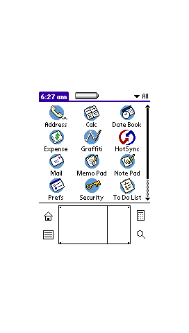
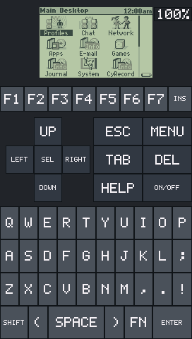
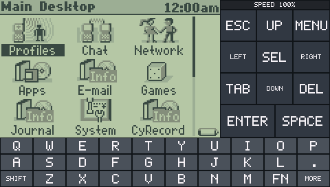
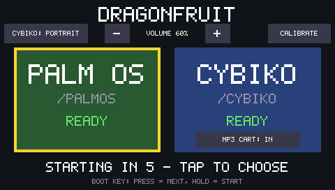

# Dragonfruit: Palm OS and Cybiko Xtreme on an ESP32

Dragonfruit emulates two handhelds from around 2000 on ESP32 boards:

| System | Emulated hardware | Runs |
|---|---|---|
| **Palm OS** | Palm IIIx: Motorola MC68EZ328 "DragonBall EZ" (68000), 2 MB RAM, 160×160 mono or colour LCD | Palm OS 3.1 and 4.1 ROMs, apps from the SD card, Graffiti, sound, Palm networking over Wi-Fi |
| **Cybiko Xtreme** | Hitachi H8S/2323 at 18.432 MHz, 2 MB RAM, 512 KB flash, 160×100 four-shade LCD, RF radio | CyOS 1.5.08, games and apps from the SD card, the radio over ESP-NOW, the MP3 cartridge with MP3s and MXD videos |

The main target is the **JC4827W543** (ESP32-S3, 4.3" 480×272 screen with
resistive touch, SD slot, speaker). It boots into a menu where you pick the
system; each one loads its ROM from its own folder on a FAT32 SD card. The
original target, the **M5Paper** (ESP32, e-ink), runs Palm OS only.

Everything is written from scratch in portable C: CPU interpreters, the
on-chip peripherals of both machines and the board drivers. The same core
code also builds on a PC, headless or in a window, which is how most of the
development and testing is done.

No ROMs are included. Palm OS and CyOS are copyrighted; you supply the dumps.


**Dragonfruit is experimental.** Both emulators boot and run real software,
but expect rough edges, missing hardware and crashes, and keep copies of
anything you put on the SD card.

## Screenshots

The whole 480×272 screen of the JC4827W543 at its real size, one screen pixel
per image pixel, with the portrait layouts turned upright. The emulated LCDs are
drawn at whole-number zoom only. The images were made on a PC with the
firmware's own drawing code and the PC builds of the emulators.

| Palm OS 4.1 (Palm IIIc ROM) | Cybiko Xtreme, portrait |
|:---:|:---:|
|  |  |

The Cybiko in landscape, with the LCD at 2× zoom:



The boot menu, where you pick the system:



## Documentation

| Guide | What's in it |
|---|---|
| [JC4827W543 board guide](docs/jc4827w543.md) | Wiring, building, flashing, the boot menu, the SD card, touch calibration, Palm RAM and storage |
| [Cybiko Xtreme](docs/cybiko.md) | Files, storage, games, controls, sound, radio, the MP3 cartridge, the desktop app |
| [How the emulator models the Cybiko](docs/cybiko-internals.md) | Which file models what, emulator choices and additions |
| [Cybiko radio over ESP-NOW](docs/cybiko-radio-protocol.md) | Carrying Cybiko packets between boards; a C library for other ESP32 projects |
| [MP3 cartridge in the emulator](docs/cybiko-mp3-cartridge.md) | Using the cartridge, its card folder, making MXD clips |
| [cybiko-docs](https://github.com/SovGVD/cybiko-docs) | The Cybiko Xtreme itself: hardware, CyOS, file formats, radio and chat protocol, CyWIG, MP3 cartridge |
| [Palm networking over Wi-Fi](docs/wifi.md) | PPP from Palm OS to Wi-Fi, the setup portal, the web proxy |
| [Palm native ROM calls](docs/palm-native-rom-calls.md) | Hot Palm OS ROM code run as C, and the checker that verifies it |
| [68k benchmark](src/bench/README.md) | A fixed 68000 workload for measuring the CPU core |
| [Tools](tools/README.md) | Serial console helpers and test scripts |

## Quick start (JC4827W543)

```sh
./tools/build-jc4827w543.sh
```

This creates `build-jc4827w543/dragonfruit-jc4827w543.bin`, flashed at
address `0x0` (see [Flash](docs/jc4827w543.md#flash)). Then prepare a FAT32
SD card:

```text
PalmOS/
  palm.rom       a Palm IIIx 3.1, Palm IIIx/V 4.1 or Palm IIIc 4.1 ROM (required for Palm OS)
  palm.cfg       optional settings; start from palm-jc4827w543.cfg.example
  install/       optional .prc / .pdb / .pqa files to install
  palm-card/     Palm OS 4's virtual SD card, created automatically
Cybiko/
  bootrom.bin    the 32 KB Cybiko Xtreme boot ROM (also cyrom150.bin)
  flash.bin      the 512 KB CyOS flash (also cyos_v1508.bin)
  apps/          optional games and apps, copied into CyOS at start
  card/          optional files for the emulated MP3 cartridge
  cybiko.cfg     optional settings
```

At power-on the boot menu shows both systems and whether their files were
found. Tap one, or use the BOOT button. The menu also sets the speaker volume
for both, the Cybiko screen orientation, and touch calibration. The last
choice starts by itself after 5 seconds.

## What works

### Palm OS

- Boots the Palm IIIx 3.1, IIIx/V 4.1 and IIIc 4.1 (colour) ROMs to the
  launcher, including the first-boot setup wizard.
- Stylus input: taps, the silkscreen buttons and Graffiti handwriting.
- Real-time clock and 100 Hz system tick from wall-clock time, so both stay
  correct at any emulation speed.
- Sleep and auto-off, with the BOOT button (JC4827W543) or the power key as
  the Palm power key.
- Sound: the DragonBall's PWM tones through the board's speaker.
- Apps and data: installs `.prc` / `.pdb` / `.pqa` files from the SD card,
  keeps Palm RAM on the SD card across restarts, and on Palm OS 4 shows
  `/PalmOS/palm-card` as an **SD Card** volume.
- Networking: PPP from Palm OS to the board's Wi-Fi, with a setup portal,
  NAT/DNS and an HTTPS-to-HTTP text proxy for Palm browsers.
- A configurable on-screen layout (silkscreen position and size, rotation,
  zoom), from `palm.cfg`.

### Cybiko Xtreme

- Boots CyOS 1.5.08 from the MAME `cybikoxt` dumps, with its first-run setup,
  desktop, games and apps.
- An on-screen keyboard, in portrait or landscape (integer zoom only).
- A 4 MB RAM disk (CyOS's own is 512 KB) kept on the SD card; games and apps
  dropped in `/Cybiko/apps` appear in CyOS.
- Sound through the speaker.
- The radio: Cybiko-to-Cybiko messaging and games between boards over
  ESP-NOW, each board with its own Cybiko ID.
- The MP3 cartridge, with `/Cybiko/card` as its card: MP3 playback and MXD
  videos.

## Running on a PC

The host build compiles the same emulator code with a thin stand-in for
ESP-IDF.

```sh
cmake -S src/host -B build-host
cmake --build build-host
ctest --test-dir build-host                                  # unit tests
./build-host/dragonfruit -r Palm-IIIx-3.1.rom -c 150000000   # Palm OS, headless, PNG snapshots
./build-host/cybiko_host --rom cyrom150.bin --flash cyos_v1508.bin --seconds 30 \
    --screenshot screen.pgm                                  # Cybiko, headless
```

With SDL (`-DHOST_UI=ON`), `dragonfruit --ui` opens Palm OS in a window with
the mouse as the stylus, and the `cybiko` target is a desktop Cybiko with
keyboard, sound and the MP3 cartridge:

```sh
cmake -S src/host -B build-host -DHOST_UI=ON -DCMAKE_BUILD_TYPE=Release
cmake --build build-host
./build-host/dragonfruit -r Palm-IIIx-3.1.rom --ui
./build-host/cybiko ~/Cybiko          # a folder laid out like /Cybiko on the SD card
```

`dragonfruit` options: `-c` caps the cycle count, `-i FILE` queues a PRC/PDB
to install, `--state PREFIX` restores and saves RAM, `-b DIR` exports RAM
databases, `--card DIR` exposes a folder as a Palm OS 4 expansion card,
`--profile FILE` and `--script FILE` profile a scripted run, and
`--hle-check N` checks the native ROM code against the ROM. `cybiko_host`'s
options are in [the Cybiko guide](docs/cybiko.md#pc-runner).

## How it works

- **Palm OS.** A 68000 interpreter runs the ROM; on the device a burst JIT
  compiles hot ROM blocks to native Xtensa code on the second core. A 24-bit
  bus maps RAM, the ROM and the DragonBall registers. The DragonBall model
  covers the interrupt controller, timer, RTC, GPIO, SPI (digitizer and
  battery ADC), UART, PWM sound and the LCD controller, plus the SED1375
  colour controller for the IIIc ROM. Pen input goes in through the ROM's own
  `EvtEnqueuePenPoint`. System calls, MemMove/MemSet, the Memory Manager and
  the hottest blitter loops also run as C with exactly the ROM's results,
  which cuts the 68k instructions run by 46–73%.
- **Cybiko Xtreme.** An H8S/2000 interpreter runs the boot ROM and CyOS. The
  machine model follows MAME's `cybikoxt` driver: bus controller wait states,
  timers, DMA and DTC, both serial ports, the LCD controller, the keyboard
  matrix, the AVR radio co-processor (its packets carried over ESP-NOW), the
  serial flash and the MP3 cartridge. A few hot CyOS routines (LCD updates,
  file reads, decompression, the video player's loops) run as C with their
  original timing.
- **Board.** Display, touch, SD, audio and Wi-Fi are separate components
  shared by both systems; each system only sees its own emulated hardware.

## Performance

On the JC4827W543 both systems run near real speed while busy, depending on
what's running. The Cybiko core runs from internal RAM; games run at full
speed and MXD videos at 85–100% of real time on the board. The Palm 68k core
uses the JIT and the native ROM calls; the board logs the emulated MHz every
5 seconds (`EMU x MHz while busy`, a real Palm IIIx runs at 16.58 MHz). See
[Cybiko speed](docs/cybiko.md#speed-on-the-board) and
[Palm native ROM calls](docs/palm-native-rom-calls.md).

Turn the Palm JIT off with `CONFIG_M68K_JIT` in menuconfig, and the native
ROM calls with `cpu.native = 0` in `palm.cfg`.

## Portability

- **Core, portable C.** The CPU cores, the peripheral models, the buses and
  the OS integration (Palm pen input, installer, backup; the Cybiko RAM disk
  and apps) have no ESP-IDF or board dependencies, which is what lets the PC
  build run the same code.
- **JIT backend, per instruction set.** The 68k JIT's code generator sits
  behind a backend interface. The Xtensa backend (ESP32, ESP32-S3) is
  complete; an ESP32-P4 (RISC-V) build runs interpreter-only.
- **Board drivers.** Display, touch, SD, audio and battery live in their own
  components, so a new board means new drivers, not changes to the core.

The ESP32 needs external PSRAM (emulated RAM and ROM images live there) and
two cores.

## Hardware

**JC4827W543:** ESP32-S3, 4 MB flash, 8 MB octal PSRAM, NV3041A 480×272 QSPI
display, XPT2046 resistive touch, microSD, I2S speaker amplifier. Pins and
details are in the [board guide](docs/jc4827w543.md).

**M5Paper (Palm OS only):** ESP32-D0WDQ6-V3, 16 MB flash, 8 MB PSRAM, IT8951
e-ink controller with a 960×540 panel, GT911 capacitive touch. Build it in a
separate directory with `IDF_TARGET=esp32` and
`SDKCONFIG_DEFAULTS=sdkconfig.defaults`:

```powershell
./build.ps1 -B build-m5paper -D IDF_TARGET=esp32 -D SDKCONFIG=sdkconfig.m5paper -D SDKCONFIG_DEFAULTS=sdkconfig.defaults build
./flash.ps1 -BuildDir build-m5paper -Port COM5 -Monitor
```

The M5Paper reads `/PalmOS/palm.rom` and the optional `palm.cfg`
(see [`palm.cfg.example`](palm.cfg.example)), `digitizer.cfg`, `install/` and
`backup/` (hold the UP side button to back up, DOWN to restore) from the SD
card. These scripts build in an ESP-IDF Docker container and flash from the
host with `esptool` and `pyserial`.

## Repository layout

```
src/
  main/             Entry point, FreeRTOS tasks, the boot menu, touch calibration,
                    serial debug console
  components/
    board/          Board pins and features (JC4827W543, M5Paper)
    display/        Display drivers (NV3041A, IT8951) and the screen compositor
    input/          Touch (XPT2046, GT911) and buttons
    m5_sd/          SD card mount and SPI bus sharing
    audio/          I2S speaker output, shared by both systems
    layout/         Screen-to-Palm coordinate mapping
    m68k/           68000 interpreter, burst JIT, native Palm ROM calls
    bus/            Palm address space: RAM, ROM, peripherals, SED1375 colour controller
    dragonball/     MC68EZ328 peripherals
    rom_loader/     Loads the Palm ROM from SD into PSRAM
    config/         palm.cfg
    installer/      Installs PRC/PDB/PQA into Palm RAM; backup and restore
    ram_state/      Palm RAM checkpoints on the SD card
    palm_card/      Palm OS 4 virtual expansion card
    wifi_gateway/   Palm PPP to Wi-Fi, setup portal, web proxy
    h8s/            H8S/2000 interpreter
    cybiko/         Cybiko Xtreme machine model and native CyOS routines
    cy_mp3/         MP3 cartridge
    cy_vfat/        Shows the card folder to the cartridge as a FAT16 disk
    cybiko_app/     Runs the Cybiko on the board: screen, keyboard, RAM disk, radio
  host/             PC builds: dragonfruit (Palm), cybiko_host and cybiko (Cybiko),
                    unit tests
  bench/            68000 benchmark
tools/              Build script, serial console helpers, profiling and Cybiko file tools
docs/               Guides and references
```

`reference/` (not committed) holds third-party emulators and datasheets used
to understand the hardware, never copied.

## License

MIT. See [LICENSE](LICENSE) and [third-party notices](docs/third-party-notices.md).


